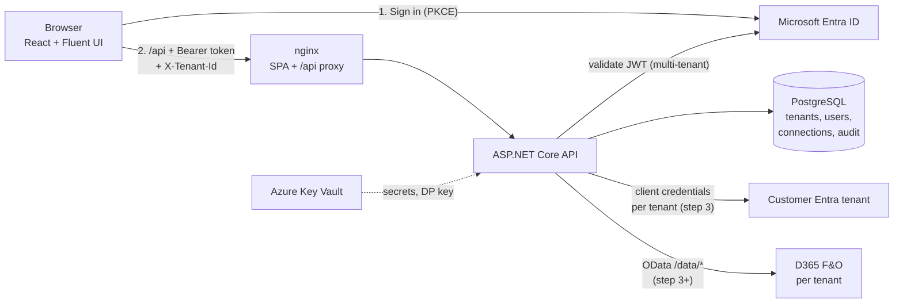

# D365 Portal

Multi-tenant web app for business users to create **Purchase requisitions, Purchase orders, Cases and General journals** in Dynamics 365 Finance & Operations through **standard OData data entities only** (no X++, no custom entities).

| | |
|---|---|
| Frontend | React 18 + TypeScript + Vite, Fluent UI v9, MSAL.js (auth code + PKCE), React Query, zustand, react-i18next, zod |
| Backend | ASP.NET Core 8 Web API, Microsoft.Identity.Web, EF Core 8 (PostgreSQL; SQL Server via provider switch) |
| Secrets | env / user-secrets locally, Azure Key Vault in production; tenant D365 client secrets encrypted with ASP.NET Data Protection |
| Tests | xUnit (+ SQLite in-memory, WebApplicationFactory), Vitest + React Testing Library |

## Build status

| Step | Scope | Status |
|---|---|---|
| 1 | Skeleton, DB schema + migrations, Microsoft login, tenant/user resolution | **Done** |
| 2 | Super-admin + tenant-admin screens, D365 connection + Test connection | Next |
| 3 | D365 OData client, company switcher, lookups | |
| 4–7 | Purchase requisitions, Purchase orders, Cases, General journals | |
| 8 | Audit log viewer, remaining tests, hardening | |

## Architecture



The browser never calls D365 and never sees D365 secrets.

### Request pipeline (backend)

`ForwardedHeaders → ExceptionHandler → CORS → Authentication (Entra JWT) → TenantResolutionMiddleware → RateLimiter → Authorization → endpoint`

- **Authentication** — `Microsoft.Identity.Web`, authority `organizations` (any work account), audience = API app, scope `access_as_user` required on every endpoint (fallback policy).
- **TenantResolutionMiddleware** — reads `oid`/`tid`; if `X-Tenant-Id` is sent, checks the caller is an **active, bound** user of that **active** tenant, otherwise `403 tenant_access_denied`. Pins the request's `TenantContext`.
- **Policies** — `SignedIn`, `TenantUser`, `TenantAdmin`, `SuperAdmin`. Tenant endpoints without a resolved tenant return `403 tenant_required`.
- **Data isolation (two layers)**
  1. EF global query filters on every tenant-owned table (`TenantId == current`). No tenant resolved → zero rows (fail-closed). Platform audit rows (`TenantId NULL`) are excluded explicitly.
  2. `SaveChanges` guard: a tenant-scoped request cannot insert/update/delete another tenant's row or change a `TenantId`; only super-admin *platform scope* may.
- **Errors** — RFC 7807 `application/problem+json` with a stable `code` the UI switches on.

### Sign-in & tenant resolution

1. SPA signs in with Microsoft (MSAL, PKCE) and calls `POST /api/session`.
2. API matches the account to `AppUser` rows:
   - already bound → by `tid + oid` only;
   - not yet bound (provisioned by an admin with just an email) → by sign-in name (UPN / `preferred_username`, case-insensitive) **only if the account's Entra directory (`tid`) is in the tenant's `AllowedEntraTenantIds`**, then bound to that `tid + oid`. The unverified `email` claim is never used. Once bound, no other account can use the row, and an account is bound to at most one user per tenant (unique index).
3. Users are **never auto-created**. No memberships → **Not authorized** page.
4. One tenant → opens it. Several → tenant picker (choice kept for the browser session; "Switch organization" in the user menu).
5. Super-admins are configured (`Platform:SuperAdmins` = `tid + oid` pairs), not stored in the database.

### Data model

| Table | Key columns |
|---|---|
| `tenants` | Id, Name, Slug (unique), IsActive, CreatedAt, AllowedEntraTenantIds |
| `d365_connections` | 1 per tenant: EnvironmentUrl, EntraTenantId, ClientId, ClientSecretEncrypted, ApiVersion, IsActive, LastTestedAt, LastTestResult |
| `app_users` | TenantId, MicrosoftObjectId, MicrosoftTenantId, Email (unique per tenant), DisplayName, Role (User/TenantAdmin), DefaultCompany, CurrentCompany, IsActive, LastLoginAt |
| `user_company_access` | (UserId, Company) + TenantId |
| `audit_logs` | Timestamp, TenantId (null = platform), UserId, UserEmail, Company, Entity, Action, Request/ResponseSummary, StatusCode, Success, DurationMs, CorrelationId |
| `data_protection_keys` | ASP.NET Data Protection key ring (shared by all API instances) |

## Setup

### 1. Entra ID app registrations for the portal (once, in your own directory)

**A. `D365 Portal - API`**
1. Entra admin center → App registrations → New registration. Supported account types: **Accounts in any organizational directory (multitenant)**. No redirect URI.
2. **Expose an API** → Set Application ID URI to `api://<API client id>` → **Add a scope** `access_as_user` (Admins and users can consent).
3. Manifest → set `"requestedAccessTokenVersion": 2`.
4. Copy the **Application (client) ID** → `API_CLIENT_ID`.

**B. `D365 Portal - Web`**
1. New registration, **multitenant**, platform **Single-page application**, redirect URIs: `http://localhost:5173`, `http://localhost:8080`, and your production URL.
2. **API permissions** → Add → My APIs → `D365 Portal - API` → delegated `access_as_user`.
3. Back on the API app → **Expose an API → Add a client application** → Web client id, tick `access_as_user` (avoids a second consent prompt).
4. Copy the client id → `WEB_CLIENT_ID`.

**Customer organizations**: before their users sign in, a customer admin grants consent once:
`https://login.microsoftonline.com/<customer-tenant-id>/adminconsent?client_id=<WEB_CLIENT_ID>`

### 2. D365 service app (per customer tenant — used from step 2/3)

In the **customer's** Entra tenant:
1. App registrations → New (single tenant) → e.g. `D365 Portal - Service`. Certificates & secrets → New client secret.
2. In D365 F&O: **System administration > Setup > Microsoft Entra ID applications** → New → Client ID = the app's client id, Name, **User ID** = a D365 user whose security roles cover what the portal creates (requisitions, POs, cases, journals) in the allowed companies. Avoid `Admin`.
3. Enter EnvironmentUrl, Entra tenant id, client id and secret in the portal's D365 connection screen (step 2). The secret is encrypted at rest and never returned by the API.

### 3. Your super-admin identity

Entra admin center → Users → you → copy **Object ID**; Overview → copy **Tenant ID**. Put them in `SUPERADMIN_OBJECT_ID` / `SUPERADMIN_ENTRA_TENANT_ID`.

## Publish to Azure

Recommended hosting, source control and the one-time setup are in **[docs/deployment.md](docs/deployment.md)**: Azure Container Apps + PostgreSQL Flexible Server + Key Vault, deployed from a private GitHub repo by GitHub Actions (`.github/workflows`), infrastructure in `infra/main.bicep`.

## Run locally

### Docker (everything)
```bash
cp .env.example .env      # fill WEB_CLIENT_ID, API_CLIENT_ID, super-admin, SEED_ADMIN_EMAIL
docker compose up --build
# Web:     http://localhost:8080
# API:     http://localhost:5080/swagger
```
Migrations run on API start (`Database__MigrateOnStartup=true`).

### Without Docker (hot reload)
```bash
docker compose up -d db

cd backend/src/D365Portal.Api
dotnet user-secrets set "AzureAd:ClientId" "<API_CLIENT_ID>"
dotnet user-secrets set "Platform:SuperAdmins:0:TenantId" "<your tid>"
dotnet user-secrets set "Platform:SuperAdmins:0:ObjectId" "<your oid>"
dotnet user-secrets set "Seed:Enabled" "true"
dotnet user-secrets set "Seed:AdminEmail" "you@yourcompany.com"
dotnet user-secrets set "Seed:EntraTenantIds" "<your tid>"
dotnet run                                  # http://localhost:5080/swagger

cd ../../../frontend
cp .env.example .env.local                  # fill VITE_ENTRA_CLIENT_ID and VITE_API_SCOPE
npm install && npm run dev                  # http://localhost:5173
```

### Demo tenant & user
With `Seed:Enabled=true`, startup creates tenant **demo** ("Demo Company") with `Seed:AdminEmail` as **TenantAdmin**, access to `Seed:Companies` (first one is the default), and `Seed:EntraTenantIds` (your directory id) as the allowed Entra directory. Sign in with that Microsoft account; the row is bound to your account on first sign-in. The seed is idempotent.

## Configuration reference (API)

| Key (env var uses `__`) | Purpose |
|---|---|
| `ConnectionStrings:Default` | Database connection string |
| `Database:Provider` | `Postgres` (default) or `SqlServer` |
| `Database:MigrateOnStartup` | Apply EF migrations at startup |
| `AzureAd:ClientId` | API app registration client id |
| `AzureAd:TenantId` | `organizations` (multi-tenant) |
| `AzureAd:Scope` | Required delegated scope (default `access_as_user`) |
| `Platform:SuperAdmins:N:TenantId` / `:ObjectId` | Platform owners |
| `Cors:AllowedOrigins:N` | Allowed browser origins (only needed when SPA and API are on different origins) |
| `RateLimiting:PermitPerMinute` | Per user (or IP) request budget, default 300 |
| `Hosting:RequireHttps` | HSTS + HTTPS redirect (default on outside Development) |
| `Swagger:Enabled` | Expose `/swagger` |
| `KeyVault:Uri` | Load configuration/secrets from Key Vault (DefaultAzureCredential / managed identity) |
| `DataProtection:KeyVaultKeyId` | Key Vault key that wraps the Data Protection key ring |
| `ForwardedHeaders:KnownNetworks:N` | CIDRs of reverse proxies allowed to set X-Forwarded-* (loopback is always trusted) |
| `Seed:*` | Demo tenant (see above) |

Frontend (`window.__APP_CONFIG__` at runtime in Docker, `VITE_*` in dev): `entraClientId`, `entraAuthority`, `apiScope`, `apiBaseUrl`.

## Database migrations

PostgreSQL migrations live in `backend/src/D365Portal.Infrastructure/Migrations/Postgres`.
```bash
scripts/add-migration.sh postgres <Name>
```
**SQL Server**: set `Database:Provider=SqlServer`, then generate its own initial migration once:
```bash
scripts/add-migration.sh sqlserver InitialCreate
```
(Each provider has its own context subclass so migrations never mix.)

## Tests

```bash
cd backend && dotnet test          # tenant isolation, user binding, API auth/tenant pipeline
cd frontend && npm test            # config, API client, tenant choice, nav visibility, session gate flows
```

## API (step 1)

| Method | Path | Policy | Purpose |
|---|---|---|---|
| POST | `/api/session` | SignedIn | Resolve account → tenants, bind first sign-in, audit login |
| GET | `/api/me` | SignedIn | Same, without side effects |
| GET | `/api/tenant/current` | TenantUser | Selected tenant + caller role/companies |
| GET | `/health`, `/health/db` | anonymous | Liveness / DB check |
